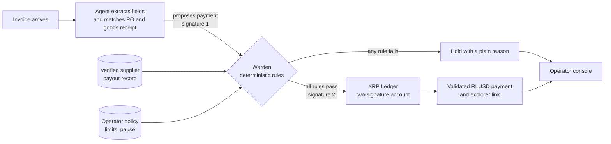

# SignOff

**An AI accounts-payable agent that cannot move money on its own.**

[](https://github.com/LethaboMH14/SignOff/actions/workflows/ci.yml)
&nbsp;XRP Ledger **Testnet** · RLUSD · Node Engine Hackathon 2026, Agentic Finance track · Team Sonar

SignOff reads supplier invoices, checks them against purchasing records, and pays the routine ones without a human click. Every payment needs two signatures. The agent holds one. The second belongs to an independent rulebook service, **Warden**, that the agent cannot read, edit or talk its way past. If a payment breaks a rule, Warden withholds its signature, and the XRP Ledger will not accept a payment with only one. Payments above a threshold need a third signature: the business owner's, on their phone.

**Demo video (under 3 minutes):** https://youtu.be/E-KNlWaLGmI

> Everything here runs on XRPL **Testnet**. Testnet RLUSD has no value. Invoices, suppliers and buyers are fictional. The rand payout to the supplier's bank is **SIMULATED**. Every claim carries a state (Live on Testnet, Simulated, Planned, Not claimed) in [Status of every claim](#status-of-every-claim).

## Live links

| What | Link | What you should see |
|---|---|---|
| Demo video | [youtu.be/E-KNlWaLGmI](https://youtu.be/E-KNlWaLGmI) | The user journey end to end, narrated |
| Routine payment, co-signed by the hosted Warden | [E1BA2278…4A5E](https://testnet.xrpl.org/transactions/E1BA22785622CBC3FAAEB2236BC4AA782128B8CDA80D412823DAEE1E1A104A5E) | Validated RLUSD payment, two signers (agent + Warden) ([T-268](docs/logs/TEST-LOG.md)) |
| 10 RLUSD payment | [821333EB…0728](https://testnet.xrpl.org/transactions/821333EBE1DBC5BAE93DDC2BE6872908A62EF7F1617C823A19305E0DF76A0728) | 10 RLUSD delivered, two signers ([T-267](docs/logs/TEST-LOG.md)) |
| High-value payment, owner approved in Xaman | [2A6FDB95…D9FD](https://testnet.xrpl.org/transactions/2A6FDB95A4D393165A45B64ABA9E07E735AFF7A69C1960F615902CD8D67DD9FD) | Ledger 22300977, three signers (agent + Warden + owner) ([T-273](docs/logs/TEST-LOG.md), [docs/HIGH-VALUE.md](docs/HIGH-VALUE.md)) |
| Hosted Warden (Railway) | [/v1/health](https://warden-production-4f0fcb91.up.railway.app/v1/health) | `"ready":true`. Every other route refuses an unsigned request with 401 |
| Operator console, SIMULATED replay (Vercel) | [signoff-console-simulated.vercel.app](https://signoff-console-simulated.vercel.app) | Sign in with the demo viewer account below, open **Agent map**, press "Play a clean invoice" and "Play a bank-detail change attack" |

**Judge logins** for the simulated console are shown on its sign-in page: a read-only viewer and a judge operator. It is a read-only viewer on a replay that never touches the Warden or the ledger, so it guards no real data ([D-154](docs/logs/DECISION-JOURNAL.md)).

## Run it yourself

Requires **Node 24** (`.nvmrc`) and git. Works on Windows, macOS and Linux.

### 1. Two minutes, no keys

```bash
git clone https://github.com/LethaboMH14/SignOff.git && cd SignOff
npm ci
npm run judge:check   # payment and injection tests, plus the labelled-set re-run against the committed result: 0 fail
npm run attack        # 26 of 26 attack cases held, refused or rejected by the Warden
```

### 2. Five minutes, no keys

```bash
npm run check         # format, lint (0 warnings), types, secret scan, 150 test files / 1,681 tests with coverage, build
npm run demo:verify -- 2A6FDB95A4D393165A45B64ABA9E07E735AFF7A69C1960F615902CD8D67DD9FD
                      # reads a paid invoice straight from Testnet: validated, tesSUCCESS, RLUSD issuer, signer count
```

### 3. The full live run (about 15 minutes, free accounts only)

You need a free [Groq API key](https://console.groq.com/keys). Testnet accounts come from the public faucet.

```bash
cp .env.example .env              # then set GROQ_API_KEY; everything else is optional
npm run testnet:provision         # six Testnet accounts from the faucet, trust lines, test token
npm run testnet:signers           # signer list: agent 1 + Warden 1, quorum 2, master key disabled
npm run testnet:funds -- status   # RLUSD held and the Testnet DEX depth (fund RLUSD as the runbook says)
npm run demo:prepare              # buyer records, Warden config and keys, agent identity (outside the repo)
npm run demo                      # starts Warden, agent and console; one fictional invoice goes to Paid
```

Open http://127.0.0.1:4180 to watch it on the desk and the Agent map. `npm run demo -- --email` adds emailed invoices ([docs/EMAIL-DEMO.md](docs/EMAIL-DEMO.md)); `npm run demo -- --zar 60.00` with the Xaman keys runs a high-value payment the owner approves on their phone ([docs/HIGH-VALUE.md](docs/HIGH-VALUE.md)). A fresh Testnet account has no RLUSD, so fund it first (see `npm run testnet:funds -- status`). The public Testnet DEX was thin on 13 November (about 4 RLUSD available), so if funding is not possible, the published payments above are the reference and `npm run demo:verify` checks them. Demo invoices are R16 to R60; sizing and funding are in [docs/RLUSD-TESTNET-RUNBOOK.md](docs/RLUSD-TESTNET-RUNBOOK.md). Seeds and keys are written to your local SignOff folder, never into the repository.

## The problem

Paying a supplier is the one finance step that businesses will not automate, because a wrong payment is usually irreversible and the loss usually stays with the payer.

- **Email payment fraud is large and rising.** It cost US$3.05 billion in reported US losses in 2025, and 74% of surveyed US organisations were hit ([FBI](https://www.mcdonaldhopkins.com/insights/news/the-sobering-truth-of-the-fbis-2025-internet-crime-complaint-center-report), [AFP via Nacha](https://www.nacha.org/news/business-email-compromise-attempts-rose-sharply-2025-report-finds)). These are US figures; they show the pattern, not South African scale.
- **Africa is a growing target.** African cybercrime losses rose from US$192 million to US$484 million in a year, and INTERPOL links more than half of it to AI ([INTERPOL 2026](https://www.interpol.int/en/News-and-Events/News/2026/INTERPOL-report-finds-AI-linked-to-more-than-half-of-cybercrime-in-Africa)). A secondhand report says 70% of Africa's detections of this fraud were in South Africa; we have not yet confirmed that in INTERPOL's own report.
- **South Africa has no published total for this specific fraud.** For context only: all reported digital banking fraud in South Africa reached R2.4 billion in 2025, up 29% ([SABRIC via BusinessTech](https://businesstech.co.za/news/banking/872115/r2-4-billion-stolen-from-south-africans-over-r21800-per-person/)). That figure is mostly fraud against individuals and **does not measure** invoice-redirection losses.
- **AI agents can be hijacked by text hidden in a document.** In published tests, eight defences that rely on the model policing itself were each broken more than half the time ([Zhan et al., 2025](https://consensus.app/papers/details/cadf2fb6ff3b5d138c4b896604a4e7ba/?utm_source=claude_desktop)).

So the manual check is the only defence, which makes payment slow. When the check is skipped, the money is gone. Handing the job to an AI makes it faster and adds a new way to be robbed. Every figure, with its confidence rating, is in [docs/PROBLEM.md](docs/PROBLEM.md).

## The idea in plain language

Think of a company chequebook that needs two signatures.

- The AI assistant holds one pen and does the paperwork.
- The second pen belongs to a rulebook. The AI cannot change the rulebook or persuade it.
- If a payment breaks a rule, the rulebook does not sign, and the bank refuses a cheque with one signature.
- The "bank" here is a public ledger, so anyone can check that the two-signature requirement is switched on.

## How it works



1. A text PDF invoice arrives and triggers the agent. Nobody clicks.
2. The agent extracts invoice fields with their source text and matches them to a purchase order and a goods-received record.
3. The agent proposes a payment to the Warden over a signed HTTP API (`POST /v1/proposals`) and signs it. It cannot submit anything alone. (An MCP interface for this call was planned and is not built; see [docs/JUDGING.md](docs/JUDGING.md).)
4. Warden checks the proposal against the rules below, using records the agent cannot alter.
5. If every rule passes, Warden adds the second signature and submits an RLUSD payment on XRPL Testnet. The console shows the validated result with an explorer link.
6. If any rule fails, the invoice is held and the operator sees why.

## What the ledger guarantees and what Warden checks

| Guarantee | Enforced by |
|---|---|
| No payment unless signer weights reach the quorum; no single key reaches it | **XRP Ledger**, once the signer list is configured and tested |
| Payee matches the supplier's verified payout record | Warden |
| Invoice matches a purchase order and goods-received record | Warden |
| No duplicate payment | Warden |
| Per-payment, per-supplier and daily limits | Warden |
| Only a plain RLUSD payment; nothing that changes signers or settings | Warden |
| Operator pause stops new payments | Warden |

Once configured and tested, the ledger stops the agent from paying alone, even if the agent is tricked or its key is stolen. The full signer matrix, including why there is no recovery signer, is in [docs/TRUST.md](docs/TRUST.md#signer-configuration-and-every-signing-path). The ledger does **not** check payees, invoices or limits; Warden does, as a separately deployed service. Key holders, supplier enrolment, key rotation, recovery and the limits of supplier-signed records are in [docs/TRUST.md](docs/TRUST.md).

## The rules a payment can break

| Group | Rule | What it stops |
|---|---|---|
| Who is paid | Destination matches the supplier's verified payout record | Fake "our bank details changed" emails |
| Who is paid | New or changed details wait out a cooling-off period and are confirmed out of band | Rushed fraud |
| What is paid | Invoice matches a purchase order and a goods-received record | Invoices for goods never ordered or delivered |
| What is paid | The same supplier and invoice number is never paid twice | Duplicates |
| What is paid | Missing fields or an unsure agent means hold | Hidden instructions in a document |
| How much | Per-payment, per-supplier and daily limits | Large losses and split payments |
| How much | Amount equals the invoice exactly | Inflated or partial payments |
| How | Only a plain payment in the agreed currency | The agent granting itself more power |
| System | Operator pause, one payment in flight, refuse if the ledger cannot be read | Race conditions and failing open |

A human operator sets the limits, the approved suppliers, the cooling-off length and the pause. More in [docs/SOLUTION.md](docs/SOLUTION.md).

## Who it is for

- **The buyer pays and controls.** A business outside South Africa, such as a Lusaka distributor, runs the agent, holds the spending account and sets the limits.
- **The South African supplier is the way in.** It enrols, has its identity and bank account verified, signs its payout details, and invites its buyers. One wholesaler can bring many buyers.

This positioning was accepted by the team on 10 November 2026 ([ADR 0001](docs/decisions/0001-supplier-anchored-reframe.md)) as a **go-to-market hypothesis**. Who buys, who pays and who authorises onboarding have not been validated with any customer. The business case, competitors and a user story are in [docs/BUSINESS.md](docs/BUSINESS.md).

## Status of every claim

Updated 14 November 2026 for judging. Branch and pull-request names in this table record where each item was first built and reviewed; the release branch `release/judging` carries all of them. High-value owner approval is live on Testnet (ledger 22300977, [T-273](docs/logs/TEST-LOG.md)).

| Item | Planned | Live on Testnet | Simulated in demo | Validated with customers |
|---|---|---|---|---|
| Agent run on an invoice file | Yes | **Live on Testnet, end to end, on branch feat/credentials-escrow-x402.** One command starts the Warden, the agent and the console; a fictional R20.00 invoice goes from intake to reconciled in about 12 seconds, paid once in RLUSD with two signers ([TEST-LOG T-251](docs/logs/TEST-LOG.md), [T-257](docs/logs/TEST-LOG.md)). Repeated by the operator from their own terminal ([T-260](docs/logs/TEST-LOG.md)). The invoice is a fictional demo invoice written by the launcher. Its fields are read by a live model: the agent log records `groq:openai/gpt-oss-120b`, one call per invoice, on each paid run ([T-260](docs/logs/TEST-LOG.md)) | Built and tested in software: intake, source-quoted extraction, injection screen, matching, decision log and audit export ([TEST-LOG T-076 to T-086](docs/logs/TEST-LOG.md)). Gate C reliability is merged only into the Gate C branch ([PR #49](https://github.com/LethaboMH14/SignOff/pull/49)); the Gate C PR itself is open ([PR #44](https://github.com/LethaboMH14/SignOff/pull/44)), not on `main`. Simulated evaluation on 30 fictional invoices: the pipeline decides 30 of 30 with no false approvals. SIMULATED stand-in, not a model measurement (reproduced by [the judge check](docs/logs/TEST-LOG.md), T-116). That 30-case report was replaced on 12 November by the 62-case [fixture report](apps/agent/results/fixture-eval.md): the pipeline passes 2 of 40 should-hold cases as eligible before the Warden's checks, against 32 of 40 for the single-prompt baseline (regenerated 13 November after five label changes under D-101 and newer screen checks; the judge check re-runs it). FIXTURE stand-ins, no model called | Not claimed |
| Live model runs on the labelled set (Groq, Gemini, OpenRouter) | Yes | Not a Testnet step. Measured once per provider on branch feat/C5-live-providers, carried in open [PR #56](https://github.com/LethaboMH14/SignOff/pull/56), not merged. The pipeline model call failed on 21 (Groq), 20 (Gemini) and 22 (OpenRouter) of 30 cases, so its holds are mostly failed calls. UNVERIFIED on this branch | Not applicable | Not claimed |
| Two-signature RLUSD payment | Yes | **Live on Testnet.** First 1 RLUSD in ledger 22255596, hash `3CCC034B2A36A8567625875B4C32B0AC5D3B1875696706ABA27858B1586265F9` ([TEST-LOG T-059](docs/logs/TEST-LOG.md)). Agent-driven 1.2 RLUSD payments: ledger 22279257 ([T-251](docs/logs/TEST-LOG.md)), ledger 22280067 with the supplier credential in place ([T-257](docs/logs/TEST-LOG.md)), and ledger 22286994, hash `84CDE6E59226732E7543B848EA60201DDA73FCA57777C1EC9E69A1839F88A668` ([T-260](docs/logs/TEST-LOG.md)). Each: tesSUCCESS, RLUSD from the expected issuer, two signers, no single-key signature. Testnet RLUSD has no real value. **The 10 RLUSD run:** ledger 22293237, hash `821333EBE1DBC5BAE93DDC2BE6872908A62EF7F1617C823A19305E0DF76A0728`, tesSUCCESS, 10 RLUSD delivered from the expected issuer, two signers ([T-267](docs/logs/TEST-LOG.md)). An emailed invoice was paid in ledger 22292899 ([T-264](docs/logs/TEST-LOG.md)). The same path ran earlier with the test-issued token TST, not RLUSD ([T-053](docs/logs/TEST-LOG.md)) | Not applicable | Not claimed |
| Rejection of a single-key payment | Yes | Live on Testnet: the agent alone and the Warden alone were refused with tefBAD_QUORUM ([TEST-LOG T-054](docs/logs/TEST-LOG.md)) | Not applicable | Not claimed |
| Warden rules, holds and operator limits | Yes | Live on Testnet with a test-issued token, not RLUSD: refusals and holds for duplicates, payee, receipt, limit, concurrency, pause, a lowered limit and a non-payment co-signature ([TEST-LOG T-071](docs/logs/TEST-LOG.md)); a frozen line held, then paid ([T-072](docs/logs/TEST-LOG.md)); the P0 pause proof, live ([T-124](docs/logs/TEST-LOG.md)). Gate B code is merged only into the Gate B branch ([PRs #48 to #54](https://github.com/LethaboMH14/SignOff/pull/54)); Gate B itself is open ([PR #27](https://github.com/LethaboMH14/SignOff/pull/27)) | Not applicable | Not claimed |
| Supplier enrolment and signed payout record | Yes | Enrolment and two-person approval recorded by the Warden on Testnet ([TEST-LOG T-071](docs/logs/TEST-LOG.md)); signed payout change tested in software only ([T-069](docs/logs/TEST-LOG.md)) | Identity check simulated: a fixed allow-list stands in for bank account verification and registry lookup, and every result says so ([identity.ts](apps/warden/src/identity.ts)) | Not claimed |
| Invoices, suppliers and buyers | Yes, fictional test data | Not claimed | Fictional only: the labelled set of 30 invoices ([fixtures](apps/agent/fixtures/labelled)) | Not claimed |
| Rand conversion and payout to a supplier's bank | Simulated only (D4) | Not claimed | Yes, labelled SIMULATED: the receipt shows a rand figure at a placeholder rate ([TEST-LOG T-105](docs/logs/TEST-LOG.md)) | Not claimed |
| Bank account verification (AVS) | Not built as a separate check | Not claimed | Not built. The simulated identity check above stands in for it ([identity.ts](apps/warden/src/identity.ts)) | Not claimed |
| Accounting system links (Xero, Sage) | Not claimed | Not claimed | Not built: no code in the repository (nothing to link; no test-log entry) | Not claimed |
| Signer list: Agent + Warden the only accepted path; each key alone rejected | Yes (ADR 0004 test plan) | Live on Testnet: quorum 2, master key disabled, read back ([TEST-LOG T-052](docs/logs/TEST-LOG.md)); single-key refusals ([TEST-LOG T-054](docs/logs/TEST-LOG.md)). On `main` through [PR #19](https://github.com/LethaboMH14/SignOff/pull/19) | Not applicable | Not claimed |
| Arduino Warden Switch: one-way pause, Warden-confirmed status; optional RFID | Stretch ([ADR 0005](docs/decisions/0005-arduino-operator-hardware.md)); [judge runbook](docs/ARDUINO-JUDGE-DEMO-RUNBOOK.md) | Not built | Not built: stretch items S1 to S4 are Todo ([ISSUES](docs/ISSUES.md)) | Not claimed |
| Permission delegation | Out of the hackathon build | Not checked (UNVERIFIED); no test-log entry | Not built | Not claimed |
| XRPL credential on verified supplier accounts (attestation only) | Stretch ([ADR 0004 test plan](docs/decisions/0004-workshop-adjustments.md)) | Lifecycle live on Testnet between two test accounts: issue, accept, check and delete all validated ([TEST-LOG T-118](docs/logs/TEST-LOG.md)). On the provisioned supplier account, the Warden's check is live in both directions: with the credential deleted, a clean invoice was held `SUPPLIER_CREDENTIAL_MISSING` and nothing was signed; restored, the next invoice paid ([T-257](docs/logs/TEST-LOG.md), [T-266](docs/logs/TEST-LOG.md)) | Not applicable | Not claimed |
| Trust line limit as one exposure layer (not a loss cap) | Yes (ADR 0004 test plan) | Not yet | Not applicable | Not claimed |
| Operator console: payment desk, held invoice and receipt (D0 to D2, D4) | Yes. Mockups approved for build and to be reworked later ([ISSUES](docs/ISSUES.md)) | Runs live against the Testnet demo: desk tabs measured in a browser at 1280 and 375 px ([TEST-LOG T-258](docs/logs/TEST-LOG.md)); the Agent map follows the live log ([T-259](docs/logs/TEST-LOG.md)); an operator can send a fictional test invoice from the desk, built and tested in software, live click-through not yet run ([T-261](docs/logs/TEST-LOG.md)) | Built and tested in software, **not merged**: open in [PR #55](https://github.com/LethaboMH14/SignOff/pull/55), [PR #56](https://github.com/LethaboMH14/SignOff/pull/56) and [PR #57](https://github.com/LethaboMH14/SignOff/pull/57). The desk never shows Paid before ledger validation and reconciliation; the receipt shows the explorer link and the delivered amount ([TEST-LOG T-098 to T-105](docs/logs/TEST-LOG.md)); the redesigned layout was measured in a browser with a stub Warden and the SIMULATED replay ([T-131](docs/logs/TEST-LOG.md), [T-132](docs/logs/TEST-LOG.md)) | Not claimed |
| Limits, second approver for increases, and pause (D3, D3W) | Yes. A second approver for increases is a proposed rule ([ISSUES](docs/ISSUES.md)) | Not run on Testnet | Built and tested in software ([TEST-LOG T-095, T-104](docs/logs/TEST-LOG.md)); the browser check has not run ([T-103](docs/logs/TEST-LOG.md), UNVERIFIED) | Not claimed |
| Mobile layout and accessibility (D5) | Yes | Not applicable | Built; keyboard and accessibility scan in software ([TEST-LOG T-107](docs/logs/TEST-LOG.md)); phone-width browser check UNVERIFIED ([T-108](docs/logs/TEST-LOG.md)) | Not claimed |
| Motion: opening sequence and transitions (D7, proposed) | Yes, proposed | Not applicable | Built; reduced motion turns it off, and the Paid tick appears only after validation ([TEST-LOG T-109](docs/logs/TEST-LOG.md)); runtime checks UNVERIFIED ([T-110](docs/logs/TEST-LOG.md)) | Not claimed |
| Deployment and health checks (D6) | Yes: Warden and console on separate hosts; the host and budget await the owner's confirmation ([D-085](docs/logs/DECISION-JOURNAL.md)) | Synthetic check read the validated ledger; the account and Warden checks were not set up ([TEST-LOG T-112](docs/logs/TEST-LOG.md)). **The Warden is hosted on Railway, on its own host away from the agent**, at https://warden-production-4f0fcb91.up.railway.app (health check: /v1/health): it co-signed a paid invoice there, ledger 22293838 ([T-268](docs/logs/TEST-LOG.md), [docs/HOSTED-WARDEN.md](docs/HOSTED-WARDEN.md)). Its key is on a Railway volume, not a key service. The agent and the live console run on the operator's machine | **Deployed: the SIMULATED console** at https://signoff-console-simulated.vercel.app, behind sign-in, with a health route and 401 for signed-out reads ([T-259](docs/logs/TEST-LOG.md), [T-262](docs/logs/TEST-LOG.md)). Visitors can replay a clean invoice or a bank-detail change attack on the map; the replay stays in their browser | Not claimed |
| Judge check: one command (E3) | Yes ([ISSUES](docs/ISSUES.md)) | Testnet payments UNVERIFIED: the offline command submits none ([TEST-LOG T-116](docs/logs/TEST-LOG.md); this PR's run is logged in T-141) | `npm run judge:check`: payment and injection tests pass, and the simulated labelled set re-runs and matches the committed result, SIMULATED ([T-116](docs/logs/TEST-LOG.md)). Live results UNVERIFIED on this branch | Not claimed |
| Armed-mode heartbeat watchdog (S3, stretch) | Stretch | Not built on this branch | Built and tested on branch feat/S3-watchdog (T-101 there); open in [PR #58](https://github.com/LethaboMH14/SignOff/pull/58), not merged | Not claimed |
| Customer problem, pricing, willingness to pay | Not applicable | Not applicable | Not applicable | Not validated: no customer has been interviewed ([ISSUES E1](docs/ISSUES.md)) |
| Savings or fraud prevented | Not applicable | Not applicable | Not applicable | None claimed |

This table will be updated with transaction hashes as items go live.

## How the agent is engineered

| Discipline | What SignOff does | Evidence |
|---|---|---|
| **Prompt engineering** | Prompts are versioned and recorded with every decision. The model must quote the source text for each field it extracts, and may leave a field empty instead of guessing; an empty or unquoted field is a hold | [AGENT-RELIABILITY.md §2–3](docs/AGENT-RELIABILITY.md), `apps/agent/src/extract/` |
| **Context engineering** | A rule-based injection screen reads every document and email before any model does; a bank-change email was quarantined in 9 ms with no model call. The model sees only the invoice text, at most three calls per invoice, and never sees keys, limits or payee records | [T-265](docs/logs/TEST-LOG.md), `apps/agent/src/screen/`, [AGENT-RELIABILITY.md §6](docs/AGENT-RELIABILITY.md) |
| **Swarm engineering** | Separate roles with separate identities and keys: the agent proposes, the Warden decides and co-signs on its own host, the owner approves large payments on a phone, the console only reads. No role can complete a payment alone, and the ledger enforces it | [TRUST.md](docs/TRUST.md), [T-054](docs/logs/TEST-LOG.md), [T-268](docs/logs/TEST-LOG.md), [T-273](docs/logs/TEST-LOG.md) |
| **Graph engineering** | The agent is a fixed workflow, not a free-roaming loop: a state table defines every allowed move (received, extracted, evidence verified, Warden-eligible, signed, submitted, validated, reconciled, or held, quarantined, failed), every move is logged, and the console draws that graph live on the Agent map | `apps/agent/src/workflow/states.ts`, [T-259](docs/logs/TEST-LOG.md) |

Measured against a single-prompt baseline on 62 fictional invoices (fixture mode, no model called): 2 of 40 should-hold cases get past the agent stage, against 32 of 40 for the baseline. The Warden still checks every one ([EVALUATION.md](docs/EVALUATION.md)).

## Repository map

| Path | What it is |
|---|---|
| [`apps/agent/`](apps/agent/README.md) | The AP agent: intake (folder and email), injection screen, source-quoted extraction, PO and goods-receipt matching, FX, proposal to the Warden, decision log and audit export |
| [`apps/warden/`](apps/warden/README.md) | The independent rules service: payee, limits, duplicates, pause, credential and high-value checks; builds and co-signs the one payment shape it allows |
| [`apps/console/`](apps/console/README.md) | The operator console: payment desk, held invoices, limits and pause, receipt, live Agent map, owner notices |
| [`packages/shared/`](packages/shared/README.md) | Money rules, contracts (Zod), security helpers, logging with redaction, obligation identity |
| [`packages/xrpl/`](packages/xrpl/README.md) | XRP Ledger layer: provisioning, multisign, reliable submission, failover, rebuild |
| [`packages/warden-api/`](packages/warden-api/README.md) | The signed HTTP contract between the agent, the console and the Warden |
| [`scripts/`](scripts/README.md) | Demo launcher, Testnet commands, attack suite, judge check, secret scan, invoice generator |
| [`deploy/`](deploy/README.md) | Railway (Warden) and Vercel (simulated console) deployment files |
| [`docs/`](docs/README.md) | Every document, grouped by reader: judging, product and business, architecture and trust, runbooks, logs |

## Commands

| Group | Command | What it does |
|---|---|---|
| Check | `npm run check` | Format, lint, types, secret scan, tests with coverage, build |
| | `npm run attack` · `npm run judge:check` | Warden attack suite · one-command judge check (offline) |
| Demo | `npm run demo` | Warden, agent and console; one fictional invoice end to end on Testnet |
| | `npm run demo -- --email` · `-- --zar 60.00` | Emailed invoices · a high-value payment with owner approval |
| | `npm run demo:verify -- <hash>` | Read a payment from Testnet without the agent or the Warden |
| Testnet | `npm run testnet:provision` · `testnet:signers` · `testnet:funds -- status` | Accounts · signer list · balances and DEX depth |
| | `npm run testnet:rejections-rlusd` | Each key alone is refused by the ledger (`tefBAD_QUORUM`) |
| | `npm run testnet:high-value` | Treasury account with agent + Warden + owner, quorum 3 |
| Agent | `npm run eval` · `npm run agent:eval -- --provider groq` | Fixture evaluation · live model on the labelled set |
| Console | `npm run console:serve` · `npm run console:operator -- list` | Serve the console · manage operator accounts |

## Contributing

Read [docs/RULES.md](docs/RULES.md) before changing anything; work starts from an issue in [docs/ISSUES.md](docs/ISSUES.md). `npm install` also installs the pre-commit secret check. See [CONTRIBUTING.md](CONTRIBUTING.md) and [SECURITY.md](SECURITY.md). Where documents differ, [BUILD-BRIEF.md](BUILD-BRIEF.md) takes precedence.

## Honest limits

- **Regulation is unsettled.** South Africa's cross-border crypto rules are still drafts. The August 2026 draft manual would let only individuals, "at this stage", move crypto assets offshore through authorised providers ([SARB](https://www.resbank.co.za/en/home/publications/publication-detail-pages/media-releases/2026/crypto-assets)). On 21 October 2026 the Minister of Finance said Treasury will take a different approach and publish a revised second draft ([MTBPS speech](https://www.gov.za/news/budget/minister-enoch-godongwana-mtbps-speech)). The buyer in this design sits outside South Africa for that reason. **This is not legal advice and no qualified lawyer has reviewed it.** See [docs/BUSINESS.md](docs/BUSINESS.md#regulation).
- **A supplier wants rand, not RLUSD.** That depends on a licensed payout partner that has not been contacted.
- **The RLUSD issuer can freeze or claw back the asset.**
- **The ledger does not check payees or limits.** If Warden is compromised together with the agent key, the loss is bounded only by the spending account's actual balance. A trust line limit does not cap that loss.
- **Upstream records can be wrong.** A compromised supplier list, purchase order or operator login defeats a perfect agent. See [docs/TRUST.md](docs/TRUST.md#threats-from-upstream-of-the-agent).
- **A stolen operator login or reserve key is outside this design's protection.** Losing either payment key freezes the small spending balance; recovery means funding a new account.
- **Live model runs did not measure accuracy.** Each provider ran once on the 30-case labelled set, on branch feat/C5-live-providers. The pipeline model call failed on 20 to 22 of 30 cases, so its holds are mostly failed calls. No accuracy is claimed (T-092 to T-094 on that branch).
- Nothing here is production software. Testnet only, no real funds.

## Licence

See [LICENSE](LICENSE).

## Testnet money and invoice sizes

Invoices are in rand, and the Testnet account pays RLUSD at a live USD/ZAR rate (about 16.7 on 12 November 2026). A R4 800 invoice would need about 287 RLUSD, far more than the Testnet account holds, so the demo invoices are R16 to R50. The sizing, the Testnet DEX limits and how to re-provision are in [docs/RLUSD-TESTNET-RUNBOOK.md](docs/RLUSD-TESTNET-RUNBOOK.md). Testnet money has no value.
