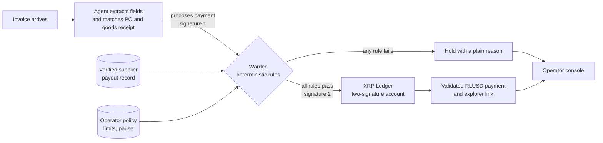

# SignOff

**An AI accounts-payable agent that cannot move money on its own.**

SignOff reads supplier invoices, checks them against purchasing records, and pays the routine ones without a human click. Every payment needs two signatures. The agent holds one. The second belongs to an independent rulebook service, called Warden, that the agent cannot read, edit or talk its way past. If a payment breaks a rule, Warden withholds its signature, and the XRP Ledger will not accept a payment with only one.

> **Status, 10 November 2026: direction agreed, build not started.**
> No application code exists. No payment has been validated, no customer has been interviewed, no partner is integrated, and no mockups exist. See [Status of every claim](#status-of-every-claim) below.

Built for the [Node Engine Hackathon](https://w3node.io/node-engine) at W3Node, Cape Town, in the Agentic Finance track. Submissions close on Friday 13 November 2026 at 23:59 SAST.

## The problem

Paying a supplier is the one finance step that businesses will not automate, because a wrong payment is usually irreversible and the loss usually stays with the payer.

- **Email payment fraud is large and rising.** It cost US$3.05 billion in reported US losses in 2025, and 74% of surveyed US organisations were hit ([FBI](https://www.mcdonaldhopkins.com/insights/news/the-sobering-truth-of-the-fbis-2025-internet-crime-complaint-center-report), [AFP via Nacha](https://www.nacha.org/news/business-email-compromise-attempts-rose-sharply-2025-report-finds)). These are US figures; they show the pattern, not South African scale.
- **Africa is a growing target.** African cybercrime losses rose from US$192 million to US$484 million in a year, and INTERPOL links more than half of it to AI ([INTERPOL 2026](https://www.interpol.int/en/News-and-Events/News/2026/INTERPOL-report-finds-AI-linked-to-more-than-half-of-cybercrime-in-Africa)). A secondhand report says 70% of Africa's detections of this fraud were in South Africa; we have not yet confirmed that in INTERPOL's own report.
- **South Africa has no published total for this specific fraud.** For context only: all reported digital banking fraud in South Africa reached R2.4 billion in 2025, up 29% ([SABRIC via BusinessTech](https://businesstech.co.za/news/banking/872115/r2-4-billion-stolen-from-south-africans-over-r21800-per-person/)). That figure is mostly fraud against individuals and **does not measure** invoice-redirection losses.
- **AI agents can be hijacked by text hidden in a document.** In published tests, eight defences that rely on the model policing itself were each broken more than half the time ([Zhan et al., 2025](https://consensus.app/papers/details/cadf2fb6ff3b5d138c4b896604a4e7ba/?utm_source=claude_desktop)).

So the manual check is the only defence, which makes payment slow. When the check is skipped, the money is gone. Handing the job to an AI makes it faster and adds a new way to be robbed. Every figure, with its confidence rating, is in [docs/PROBLEM.md](docs/PROBLEM.md).

## The idea in plain language

Think of a company chequebook that needs two signatures.

- The AI assistant holds one pen and does the paperwork.
- The second pen belongs to a rulebook. The AI cannot change the rulebook or persuade it.
- If a payment breaks a rule, the rulebook does not sign, and the bank refuses a cheque with one signature.
- The "bank" here is a public ledger, so anyone can check that the two-signature requirement is switched on.

## How it works



1. A text PDF invoice arrives and triggers the agent. Nobody clicks.
2. The agent extracts invoice fields with their source text and matches them to a purchase order and a goods-received record.
3. The agent proposes a payment through an MCP tool and signs it. It cannot submit anything alone.
4. Warden checks the proposal against the rules below, using records the agent cannot alter.
5. If every rule passes, Warden adds the second signature and submits an RLUSD payment on XRPL Testnet. The console shows the validated result with an explorer link.
6. If any rule fails, the invoice is held and the operator sees why.

## What the ledger guarantees and what Warden checks

| Guarantee | Enforced by |
|---|---|
| No payment unless signer weights reach the quorum; no single key reaches it | **XRP Ledger**, once the signer list is configured and tested |
| Payee matches the supplier's verified payout record | Warden |
| Invoice matches a purchase order and goods-received record | Warden |
| No duplicate payment | Warden |
| Per-payment, per-supplier and daily limits | Warden |
| Only a plain RLUSD payment; nothing that changes signers or settings | Warden |
| Operator pause stops new payments | Warden |

Once configured and tested, the ledger stops the agent from paying alone, even if the agent is tricked or its key is stolen. The full signer matrix, including why there is no recovery signer, is in [docs/TRUST.md](docs/TRUST.md#signer-configuration-and-every-signing-path). The ledger does **not** check payees, invoices or limits; Warden does, as a separately deployed service. Key holders, supplier enrolment, key rotation, recovery and the limits of supplier-signed records are in [docs/TRUST.md](docs/TRUST.md).

## The rules a payment can break

| Group | Rule | What it stops |
|---|---|---|
| Who is paid | Destination matches the supplier's verified payout record | Fake "our bank details changed" emails |
| Who is paid | New or changed details wait out a cooling-off period and are confirmed out of band | Rushed fraud |
| What is paid | Invoice matches a purchase order and a goods-received record | Invoices for goods never ordered or delivered |
| What is paid | The same supplier and invoice number is never paid twice | Duplicates |
| What is paid | Missing fields or an unsure agent means hold | Hidden instructions in a document |
| How much | Per-payment, per-supplier and daily limits | Large losses and split payments |
| How much | Amount equals the invoice exactly | Inflated or partial payments |
| How | Only a plain payment in the agreed currency | The agent granting itself more power |
| System | Operator pause, one payment in flight, refuse if the ledger cannot be read | Race conditions and failing open |

A human operator sets the limits, the approved suppliers, the cooling-off length and the pause. More in [docs/SOLUTION.md](docs/SOLUTION.md).

## Who it is for

- **The buyer pays and controls.** A business outside South Africa, such as a Lusaka distributor, runs the agent, holds the spending account and sets the limits.
- **The South African supplier is the way in.** It enrols, has its identity and bank account verified, signs its payout details, and invites its buyers. One wholesaler can bring many buyers.

This positioning was accepted by the team on 10 November 2026 ([ADR 0001](docs/decisions/0001-supplier-anchored-reframe.md)) as a **go-to-market hypothesis**. Who buys, who pays and who authorises onboarding have not been validated with any customer. The business case, competitors and a user story are in [docs/BUSINESS.md](docs/BUSINESS.md).

## Status of every claim

| Item | Planned | Live on Testnet | Simulated in demo | Validated with customers |
|---|---|---|---|---|
| Agent run on an invoice file | Yes | Not yet | | |
| Two-signature RLUSD payment | Yes | Not yet | | |
| Rejection of a single-key payment | Yes | Not yet | | |
| Warden rules, holds and operator limits | Yes | Not yet | | |
| Supplier enrolment and signed payout record | Yes | Not yet | Identity check simulated | |
| Invoices, suppliers and buyers | | | Fictional | |
| Rand conversion and payout to a supplier's bank | | | Yes | |
| Bank account verification (AVS) | | | Yes | |
| Accounting system links (Xero, Sage) | | | Yes | |
| Signer list: Agent + Warden the only accepted path; each key alone rejected | Yes (ADR 0004 test plan) | Not yet | | |
| Arduino Warden Switch: one-way pause, Warden-confirmed status; optional RFID | Stretch ([ADR 0005](docs/decisions/0005-arduino-operator-hardware.md)); [judge runbook](docs/ARDUINO-JUDGE-DEMO-RUNBOOK.md) | Not yet | | |
| Permission delegation | Out of the hackathon build; status on our Testnet unverified | Not checked | | |
| XRPL credential on verified supplier accounts (attestation only) | Stretch (ADR 0004 test plan) | Not yet | | |
| Trust line limit as one exposure layer (not a loss cap) | Yes (ADR 0004 test plan) | Not yet | | |
| Customer problem, pricing, willingness to pay | | | | No |
| Savings or fraud prevented | | | | None claimed |

This table will be updated with transaction hashes as items go live.

## Hackathon scoring

Judges score three areas, taken from the team's BuilderBase dashboard on 9 November 2026.

| Criterion | Weight | Where the build stands today |
|---|---|---|
| Product design | 33% | Nothing to score: no screens or mockups |
| Technical UX | 34% | Nothing to score: no code, no deployment |
| Business/Market Fit | 33% | Narrative and evidence only, no customer validation |

The track requires an autonomous transaction on XRPL Testnet or Devnet, limits enforced outside the agent's control, and a way for a human operator to change them. See [docs/HACKATHON.md](docs/HACKATHON.md).

## Documents

| Read this | For |
|---|---|
| [docs/RULES.md](docs/RULES.md) | **The working contract:** rules every change must meet, definition of done, phase-close checklist |
| [docs/PRD.md](docs/PRD.md) | Product requirements: users, goals, requirements, success measures |
| [docs/ISSUES.md](docs/ISSUES.md) | The build sliced into issues by gate |
| [docs/logs/](docs/logs/) | Build log, decision journal, test log, security log |
| [BUILD-BRIEF.md](BUILD-BRIEF.md) | The agreed build, flow, stack and acceptance tests |
| [docs/PROBLEM.md](docs/PROBLEM.md) | Problem statement and sourced evidence with confidence ratings |
| [docs/SOLUTION.md](docs/SOLUTION.md) | Rules, two-signature design, simpler options considered |
| [docs/AGENT-RELIABILITY.md](docs/AGENT-RELIABILITY.md) | How hallucination is contained and measured |
| [docs/ARDUINO-JUDGE-DEMO-RUNBOOK.md](docs/ARDUINO-JUDGE-DEMO-RUNBOOK.md) | Optional Warden Switch stage demo, human veto, safety/failure tests; not yet implemented |
| [docs/SERVICE-LEVELS.md](docs/SERVICE-LEVELS.md) | Service level targets, failure behaviour, fastest reliability measures |
| [docs/COMPLIANCE.md](docs/COMPLIANCE.md) | Obligations, who carries them, and what the build does (not legal advice) |
| [docs/CFO-AGENTIC-FRAUD-SECURITY-RESEARCH-2026-11-10.md](docs/CFO-AGENTIC-FRAUD-SECURITY-RESEARCH-2026-11-10.md) | Implementation requirements: CFO controls, fraud threats, tests, delivery gates (research; none implemented) |
| [docs/TRUST.md](docs/TRUST.md) | Ledger versus Warden guarantees, keys, enrolment, rotation, recovery |
| [docs/BUSINESS.md](docs/BUSINESS.md) | Customer, savings, revenue, feasibility, competitors, regulation |
| [docs/ENGINEERING.md](docs/ENGINEERING.md) | Repository layout, review process, tests, security, release checks |
| [docs/HACKATHON.md](docs/HACKATHON.md) | Event facts, rubric, deadlines, what is unknown |
| [docs/WORKSHOP.md](docs/WORKSHOP.md) | Notes from the Ripple track workshop and what they change |
| [docs/decisions/](docs/decisions/) | Decision records |
| [docs/RESEARCH.md](docs/RESEARCH.md) | Source index |
| [docs/CLAUDE-PLAN.md](docs/CLAUDE-PLAN.md) | Historical plan from 5 November, kept for reference |
| [CONTRIBUTING.md](CONTRIBUTING.md) · [SECURITY.md](SECURITY.md) | How to work in this repository |

Where documents differ, the build brief takes precedence.

## Developer setup

Requires Node 24 (see `.nvmrc`).

```bash
npm install    # the one install command: dependencies for every workspace, and the pre-commit secret check in a git checkout
npm run check  # formatting, lint, types, tests with coverage, and build
```

Read [docs/RULES.md](docs/RULES.md) before changing anything. Work starts from an issue in [docs/ISSUES.md](docs/ISSUES.md).

## Honest limits

- **Regulation is unsettled.** South Africa's cross-border crypto rules are still drafts. The August 2026 draft manual would let only individuals, "at this stage", move crypto assets offshore through authorised providers ([SARB](https://www.resbank.co.za/en/home/publications/publication-detail-pages/media-releases/2026/crypto-assets)). On 21 October 2026 the Minister of Finance said Treasury will take a different approach and publish a revised second draft ([MTBPS speech](https://www.gov.za/news/budget/minister-enoch-godongwana-mtbps-speech)). The buyer in this design sits outside South Africa for that reason. **This is not legal advice and no qualified lawyer has reviewed it.** See [docs/BUSINESS.md](docs/BUSINESS.md#regulation).
- **A supplier wants rand, not RLUSD.** That depends on a licensed payout partner that has not been contacted.
- **The RLUSD issuer can freeze or claw back the asset.**
- **The ledger does not check payees or limits.** If Warden is compromised together with the agent key, the loss is bounded only by the spending account's actual balance. A trust line limit does not cap that loss.
- **Upstream records can be wrong.** A compromised supplier list, purchase order or operator login defeats a perfect agent. See [docs/TRUST.md](docs/TRUST.md#threats-from-upstream-of-the-agent).
- **A stolen operator login or reserve key is outside this design's protection.** Losing either payment key freezes the small spending balance; recovery means funding a new account.
- Nothing here is production software. Testnet only, no real funds.

## Licence

See [LICENSE](LICENSE).
