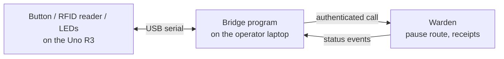

# 0005: Arduino pause button, status light and goods-received scanner

- **Status:** Proposed, 10 November 2026. Awaiting team sign-off.
- **Scope:** Stretch. Built only after delivery Gates A and B in [ENGINEERING.md](../ENGINEERING.md#delivery-gates) pass. Time-boxed to half a day.
- **Hardware:** the team's existing Arduino Uno R3 starter set.

## Context

Review of pull request 3 required a pause route that works when the operator console is down, built and tested. The track asks for human control outside the agent, and the demo happens in a crowded room where a physical control is easy to understand. The team owns an Arduino Uno R3 set.

## Decision

Three small devices, in this order:

1. **Physical pause button and light.** Pressing the button pauses Warden; a light shows running or paused.
2. **Status light.** Green when an invoice is paid (validated on the ledger), amber when held, red when paused.
3. **Goods-received scanner (only if time remains).** An RFID reader at the "warehouse"; scanning a tagged box creates a goods-received record that Warden uses in its three-way match.

## How it works with an Uno R3

The Uno R3 has no network connection and no secure key storage. So:

- The Uno only reports button presses and tag reads over USB, and lights LEDs on command. It holds **no credentials and no keys**.
- A small bridge program on the operator's laptop holds the operator credential, calls Warden's authenticated pause route, posts goods-received events, and listens for status changes to drive the lights.
- If the bridge or cable fails, nothing is paid by mistake: the pause route and receipts simply don't arrive, and the console's own pause still works.

Parts expected in a typical Uno starter set: push button, LEDs or an RGB LED, resistors, breadboard. Many sets include an RC522 RFID reader with a card and key fob; **check the set**, and skip the scanner if there is none.

## Security limits to state openly

- **Pause:** the button is only as trustworthy as the bridge's credential. The bridge authenticates as an operator; its pause calls are logged like any other.
- **Goods received:** a cheap RFID tag can be copied. A scan is evidence that a tag was presented, not proof that the goods arrived in good condition. Warden records the source ("scanner, device ID, time") and the record still carries the receiving role's approval, so a scan alone cannot create a payable. This is a demonstration of provenance, not a production control.
- **No signing on the device.** The Uno must never hold or use an XRPL key. Keys stay in the secret manager ([TRUST.md](../TRUST.md)).

## Tests before the demo

| Test | Expected |
|---|---|
| Press button with the console stopped | Warden reports paused; next proposal held; event logged |
| Press again to resume (or resume from console) | Running; logged with the operator identity |
| Unplug the Uno mid-run | No change in payments; bridge reports the device lost |
| Scan a tag for a known delivery | Goods-received record created with source and time; still needs the receiving role's approval |
| Scan an unknown tag | Ignored and logged |
| Payment validated, held, paused | Green, amber, red light respectively |

## Why

- It satisfies the reviewer's requirement for a pause route independent of the console, with a test that is visible to the judges.
- It makes "human control outside the agent" physical and easy to explain to non-technical people.
- The scanner ties a payment to a physical event, which supports the "real business" story.

## Costs

- Half a day, only after the core works.
- A new demo dependency (cable, laptop port). The console pause and the recorded video remain the fallback.
